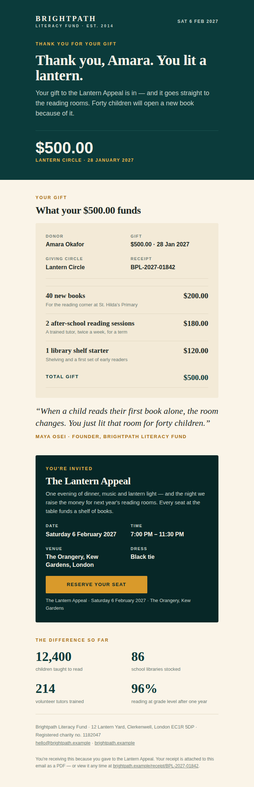
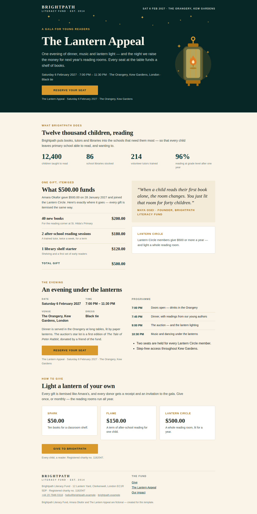
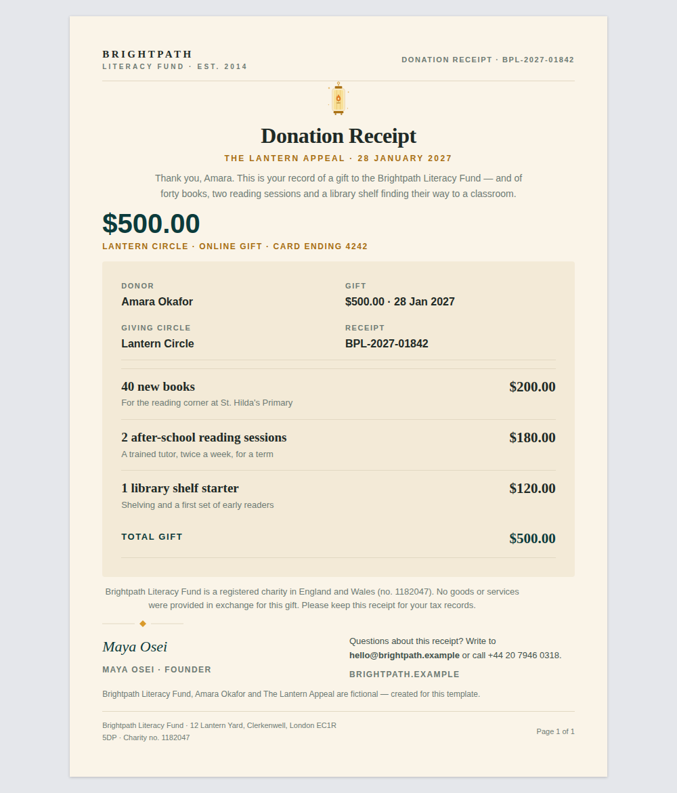
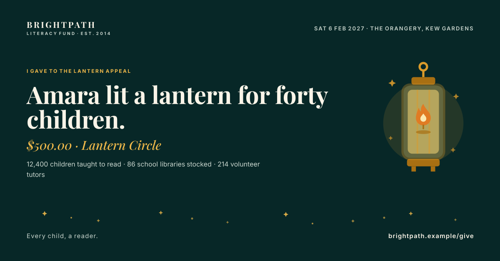

# The Lantern Appeal — a charity gala fundraiser kit

A fictional literacy charity thanks a donor and fills a gala — in four formats
from one codebase, built with [Hyper Elements](https://github.com/hyper-elements/hyper-elements)
(`@hyper-elements/react`).

**Brightpath Literacy Fund** teaches children to read. Its annual gala, *The
Lantern Appeal* (Saturday 6 February 2027, The Orangery, Kew Gardens, London),
raises the money for next year's reading rooms. This kit is everything the
appeal needs around one gift: the thank-you email to the donor, the gala and
impact page, the donation receipt, and the share card the donor posts to say
she gave. The charity, the donor, the gala and the links are all invented;
the kit is a template, ready to be re-skinned with a real appeal.

No external images anywhere: every visual is a Hyper Elements element or a
drawn `Svg` shape (the lantern, the flame, the star field, the divider
flourish).

## The four outputs

### 1. Email — the donor thank-you (600px)

A deep-teal hero (wordmark, the thank-you line, the gift in large serif), a
parchment card with the donor facts and the itemised gift breakdown, the
founder's quote, a dark gala-invitation card with the RSVP button, the impact
stats, and the charity footer. `render()` also writes the plain-text twin
(`out/email.txt`).



### 2. Page — the gala and impact page (960px)

A dark hero with the drawn lantern and a star field, the impact stats, the
gift breakdown beside the founder's quote, the evening's details and programme,
the three giving tiers, and the footer. Rows and grids wrap and stack, so it
holds together down to a phone
(see `docs/screenshots/page-mobile.png`).



### 3. Document — the donation receipt (print HTML + PDF)

Exactly one A4 page: the lantern masthead, the gift in large serif, the donor
facts and itemised breakdown, the tax note, the founder's signature, and a
repeating header and footer carrying page numbers. `render()` writes the
print HTML; `renderPdf()` writes the PDF from the same tree.



### 4. Canvas — the "I gave" share card (1200 × 627)

Dark teal ground, a star field, the donor's statement set huge in the serif,
the gift and giving circle in italic gold, the impact line, and the drawn
lantern. `renderImage()` draws it as a PNG and as an SVG (whose text is paths,
so it shows without fonts) — the SVG below is the build's own output:



## Run it

```bash
npm install
npm run build
```

`npm run build` validates all four templates (and fails on any error), then
renders everything into `out/`:

| File | What it is |
| --- | --- |
| `out/email.html`, `out/email.txt` | The thank-you email, and its plain-text twin |
| `out/page.html` | The gala and impact page |
| `out/receipt-print.html` | The receipt (print HTML) |
| `out/receipt.pdf` | The same receipt as a one-page A4 PDF |
| `out/share-card.png`, `out/share-card.svg` | The 1200 × 627 share card |
| `out/clients/*.html` | The email as Outlook, Gmail and Apple Mail draw it |

`npm run screenshots` re-captures `docs/screenshots/` from the built HTML with
Playwright's Chromium (desktop and 390px mobile). `npm run typecheck`
typechecks.

The build needs no network and no keys: the PDF and image engines are given
their fonts as WOFF files from the `@fontsource` packages, and nothing is
fetched at render time. (The HTML outputs reference the same families as web
fonts, with Georgia / Helvetica fallbacks where a client doesn't load them.)

## How Hyper Elements was used

- **One theme, four roots.** `src/theme.ts` defines the brand once with
  `defineTheme()`: the deep-teal / warm-amber / cream palette, Playfair
  Display + Inter, a type scale per heading level, the amber button, and named
  styles (`eyebrow`, `card`, `giftRow`, `amount`, `statValue`, `statLabel`)
  picked up with `style={{ apply: [...] }}`. Every root — `Email`, `Page`,
  `Document`, `Canvas` — takes the same theme, so the four outputs can't drift
  apart. Templates read tokens with `token("colors.amber")`; the theme itself
  writes them as `"{colors.amber}"`. A `formats.email` override shrinks the
  headings for the 600px email.
- **One data model.** `src/data.ts` is the single source of truth: the donor
  and her gift (money as integer cents), the gala and its programme, the
  impact stats, the gift breakdown (which sums to the gift), the giving tiers,
  and the charity's details. Change the donor or the gift there and all four
  outputs change.
- **Shared components.** `src/components.tsx` holds the blocks the roots
  share: `Wordmark`, `ImpactStats` (a `Grid`), `GiftBreakdown` (ruled rows
  with a total), `DonorFacts`, `GalaDetails`, `TierCards`, `ThankYouQuote`,
  `GalaCTA`, `GiveCTA`, and the drawn motifs `LanternMark`, `StarField` and
  `Flourish` (`Svg` shapes — the email, which doesn't support `Svg`, gets the
  same rhythm from `Divider`s and colour bands instead). The lantern is drawn
  once and reused at three sizes: the page hero, the receipt masthead, and the
  share card.
- **All four roots, each used for what it's for.** The `Email` is 600px with
  a preview text and a plain-text twin; the `Page` is 960px with wrapping
  `Row`s and `Grid`s; the `Document` is A4 with a `PageHeader`, a `PageFooter`
  carrying `PageNumber`s, and content sized to exactly one page; the `Canvas`
  is 1200 × 627 with `justifyContent: "space-between"`.
- **Validation as a build gate.** `scripts/build.tsx` runs `validate()` on
  every template before rendering anything, and fails the build on any error.
  The email is also checked with the `@hyper-elements/email-clients` plugin,
  which adds what classic Outlook, Gmail, Apple Mail and the rest remove or
  change — the build prints those notes (29 of them, all expected: no web
  fonts in most clients, no letter-spacing in Word's Outlook, square corners
  in classic Outlook, phone styles ignored in one Gmail variant).
  `renderInEmailClients()` then writes a preview per client to `out/clients/`,
  so the email can be checked as each client draws it
  (see `docs/screenshots/email-outlook.png`).
- **PDF and image from the same trees.** `renderPdf()` (via
  `@hyper-elements/react/pdf`) draws the `Document` as a one-page A4 PDF, and
  `renderImage()` (via `@hyper-elements/react/image`) draws the `Canvas` as
  PNG and SVG — both given their fonts as files, so the outputs are
  deterministic and offline.
- **One sharp edge, found the hard way.** The share card's star field
  originally placed stars at fixed coordinates, some outside the `Svg`'s
  40px-tall viewBox. The SVG rendered fine in a browser — but resvg, which
  rasterises the PNG, panicked on an opacity shape outside the viewBox.
  `StarField` now positions every star as a fraction of its own width and
  height, so no shape ever leaves the viewBox. (The same rule is worth
  remembering for any `Svg` that goes through `renderImage()`.)

## Project structure

```
lantern-appeal/
├── src/
│   ├── data.ts          the donor, the gift, the gala, the charity
│   ├── theme.ts         the brand: palette, fonts, type scale, named styles
│   ├── fonts.ts         WOFF files for the PDF and image engines
│   ├── components.tsx   shared blocks + drawn Svg motifs
│   ├── email.tsx        the donor thank-you (Email, 600px)
│   ├── page.tsx         the gala and impact page (Page, 960px)
│   ├── document.tsx     the donation receipt (Document, A4)
│   └── canvas.tsx       the share card (Canvas, 1200 × 627)
├── scripts/
│   ├── build.tsx        validate → render → PDF/image → client previews
│   └── screenshots.ts   Chromium captures of the built outputs
├── docs/
│   ├── share-card.svg   the canvas SVG, for this README
│   └── screenshots/     email, page, receipt, canvas (+ mobile, Outlook)
├── out/                 build outputs (regenerated; not committed)
├── package.json
└── tsconfig.json
```

## Make it yours

Everything editable lives in `src/data.ts`:

- **Donor and gift** — `donor.firstName`, `donor.name`, `donor.giftCents`
  (integer cents), `donor.tier`, `donor.giftDate`, `donor.receiptNumber`,
  `donor.method`. The breakdown must sum to the gift — the build prints both,
  so a mismatch is easy to spot.
- **Gift breakdown** — edit the `breakdown` array: `label`, `detail`,
  `amountCents`. Three rows fit the receipt's one page; more rows may need a
  second page (add a `PageBreak` or a second `Document.Page`).
- **Gala** — `gala.name`, `gala.date`, `gala.timeLong`, `gala.venue`,
  `gala.city`, `gala.dress`, and the `gala.programme` slots.
- **Impact** — the `impact` stats (value, label) shown in the email, on the
  page, and on the share card.
- **Tiers** — the `tiers` array: `name`, `amountCents`, `blurb`.
- **Charity** — `charity.name`, address, phone, email, site, charity number,
  and the `giveUrl` / `rsvpUrl` / `galaUrl` the buttons point to.
- **Look** — the palette and fonts live in `src/theme.ts` (`PALETTE`,
  `SERIF`, `SANS`); change them there and all four outputs re-skin. The drawn
  motifs are in `src/components.tsx`.

Then `npm run build` (and `npm run screenshots` to refresh the captures).

## License

MIT — see [LICENSE](LICENSE).
